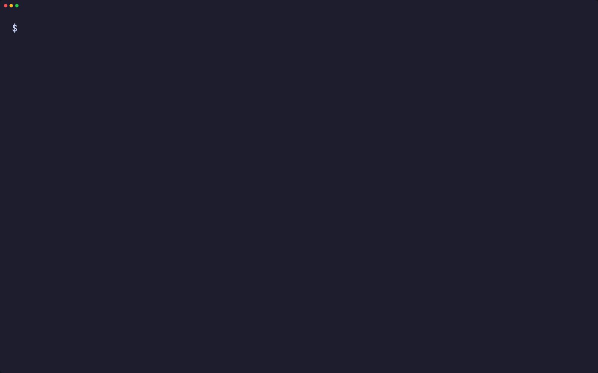
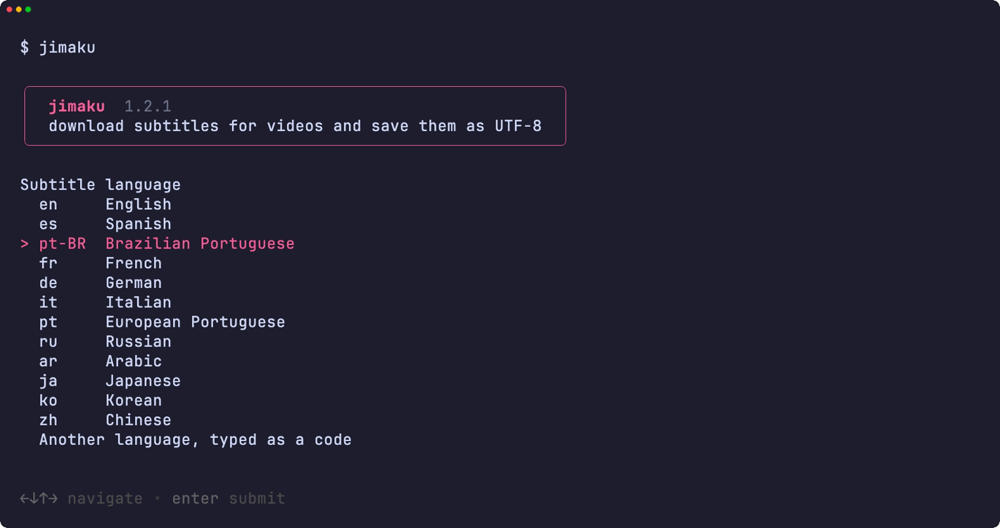
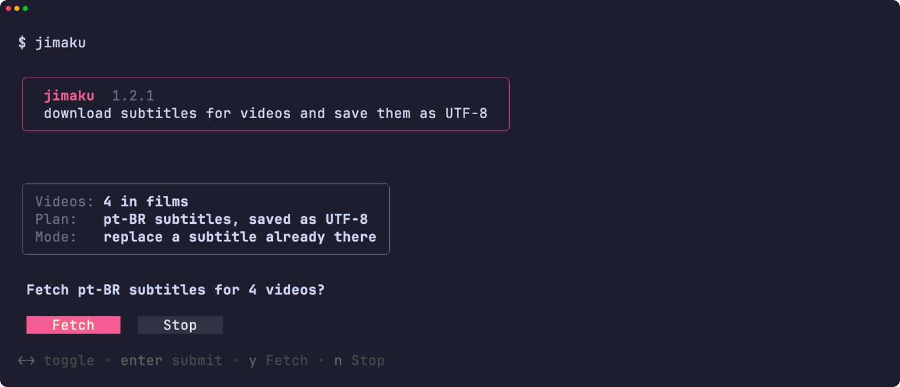
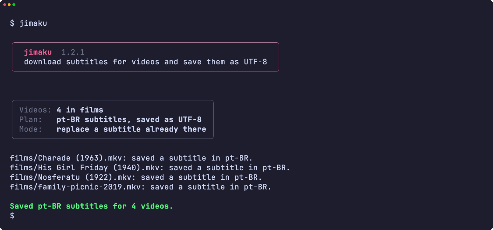
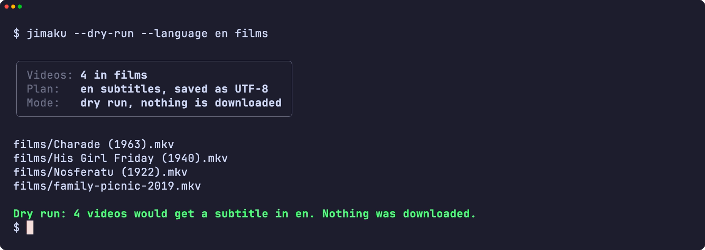
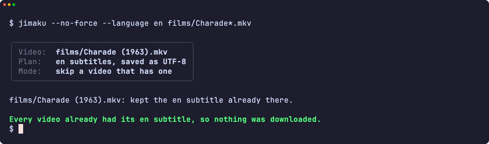
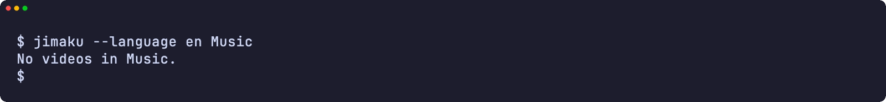
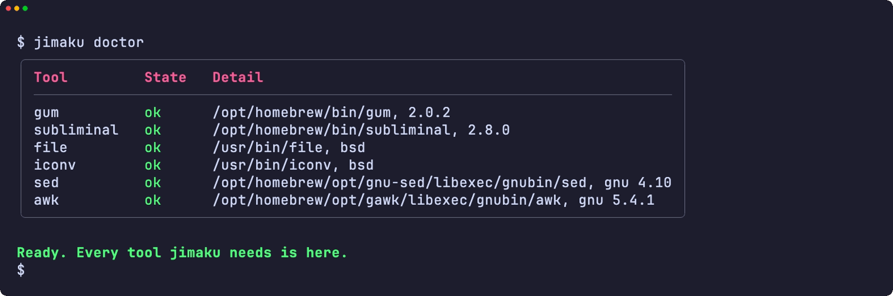
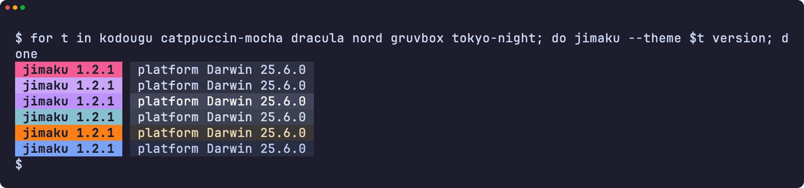
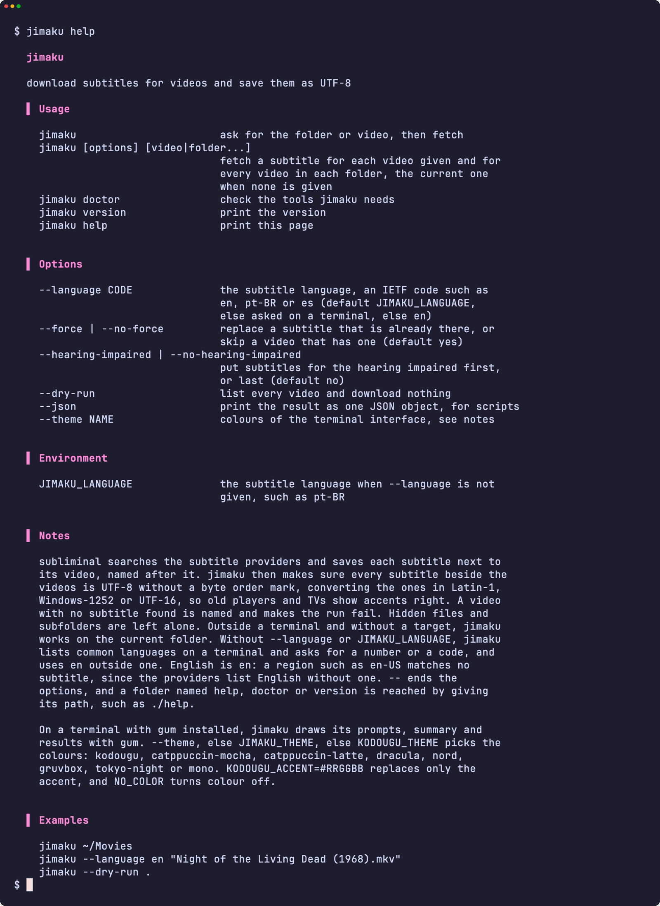

<div align="center">

<h1>jimaku</h1>

<strong>動画1本でもフォルダー丸ごとでも字幕をダウンロードし、どのプレーヤーでもアクセントが正しく出るよう、すべて UTF-8 で保存します。</strong>

[English](README.md) | 日本語 | [简体中文](README.zh-Hans.md) | [繁體中文 (香港)](README.zh-HK.md)

[](https://github.com/gufranco/jimaku/actions/workflows/ci.yml)
[](https://github.com/gufranco/jimaku/releases/latest)
[](LICENSE)

<p align="center">
  <a href="#quick-start"><strong>クイックスタート</strong></a> |
  <a href="#what-it-does">何をするか</a> |
  <a href="#development">開発</a>
</p>

</div>

コマンドは1つ、テストは163件、シェルのモジュールは11個で、POSIX システム、gum、[subliminal](https://github.com/Diaoul/subliminal) のほかに入れるものはありません。`jimaku` は日本語の「字幕」です。姉妹ツールの [kakikomi](https://github.com/gufranco/kakikomi)、[kiyome](https://github.com/gufranco/kiyome)、[shiwake](https://github.com/gufranco/shiwake)、[yakitsuke](https://github.com/gufranco/yakitsuke) は、ディスクの書き込み、ディスクの消去、フォルダーの仕分け、Video CD の作成を受け持ちます。

---

<p align="center">
  
</p>

```console
$ jimaku --language pt-BR ~/Movies

Videos: 3 in /Users/me/Movies
Plan:   pt-BR subtitles, saved as UTF-8 next to each video
        any subtitle already there is replaced

/Users/me/Movies/Metropolis (1927).mkv: saved a subtitle in pt-BR.
/Users/me/Movies/Metropolis (1927).pt-BR.srt: converted from iso-8859-1 to
UTF-8.
/Users/me/Movies/Nosferatu (1922).mp4: saved a subtitle in pt-BR.
jimaku: warning: no pt-BR subtitle found for /Users/me/Movies/The General
(1926).avi.
Saved pt-BR subtitles for 2 of 3 videos.
```

<a id="quick-start"></a>

## クイックスタート

### 必要なもの

| ツール | 用途 | 入手方法 |
|:-------|:-----|:---------|
| [`gum`](https://github.com/charmbracelet/gum) | 端末の画面：メニュー、入力、表、配色 | `brew install gum`。Homebrewのformulaが自動でインストールします |
| `subliminal` | 字幕サイトを検索し、最も合う字幕をダウンロードします | `brew install subliminal` または `apt install subliminal` |
| `file`、`iconv`、`sed`、`awk` | 字幕の文字コードを判定して変換します | どの Linux と macOS にも入っています |

### インストール

```bash
brew install gufranco/tap/jimaku
```

ソースからの場合:

```bash
git clone https://github.com/gufranco/jimaku.git
cd jimaku
make install
```

`make install` はツール、man ページ、bash、zsh、fish の補完を `~/.local` の下にコピーし、`jimaku` を `~/.local/bin` に置きます。場所は `PREFIX` で変えられます。Homebrew の formula も同じファイルを入れ、subliminal も一緒に入れます。

### 確認

```console
$ jimaku doctor
gum                ok       /opt/homebrew/bin/gum, 2.0.2
subliminal         ok       /opt/homebrew/bin/subliminal, 2.8.0
file               ok       /usr/bin/file, bsd
iconv              ok       /usr/bin/iconv, bsd
sed                ok       /usr/bin/sed, bsd
awk                ok       /usr/bin/awk, bsd 20200816
```

## 使い方

| コマンド | 目的 |
|:---------|:-----|
| `jimaku [options] [video\|folder...]` | 指定した動画と、指定したフォルダーにあるすべての動画の字幕を取得します。指定がなければ現在のフォルダーです |
| 引数なしの `jimaku` | ターミナルでは、現在のフォルダーを候補にしてフォルダーか動画を尋ね、言語が決まっていなければ言語も尋ねます |
| `jimaku doctor` | subliminal とテキスト処理ツールを、それぞれの種類とバージョン付きで表示します |
| `jimaku version`、`jimaku help` | バージョンか使い方の全文を表示します |

| オプション | 効果 |
|:-----------|:-----|
| `--language CODE` | 字幕の言語。`en`、`pt-BR`、`es` のような IETF コードです。既定は `JIMAKU_LANGUAGE`、なければターミナルで尋ね、それ以外は `en` |
| `--force`、`--no-force` | すでにある字幕を置き換えるか、字幕のある動画を飛ばします。既定は置き換え |
| `--hearing-impaired`、`--no-hearing-impaired` | 聴覚障害者向けの字幕を先にするか、後にします。既定は後 |
| `--dry-run` | 動画を一覧するだけで、何もダウンロードしません |
| `--json` | 結果を1つのJSONオブジェクトとして出力します（スクリプト向け） |
| `--theme <name>` | 端末の画面の配色 |

| 環境変数 | 効果 |
|:---------|:-----|
| `JIMAKU_LANGUAGE` | `--language` を指定しないときの字幕の言語。例は `pt-BR`。シェルのプロファイルで設定すると既定になります |

```bash
jimaku ~/Movies                                    # Movies のすべての動画
jimaku --language pt-BR "Metropolis (1927).mkv"    # 1本をブラジルポルトガル語で
jimaku --dry-run .                                 # 対象になる動画を確認
```

`--language=en` の形も使え、`--` でオプションが終わります。jimaku はファミリー共通のコマンドライン規約に従います。内容は [FAMILY.md](FAMILY.md) にあります。

### テーマ

`gum`がインストールされた端末では、jimakuはメニュー、入力、表、メッセージをgumで描きます。パイプやスクリプトでは、出力はプレーンテキストのままです。配色は`--theme`、なければ`JIMAKU_THEME`、なければ`KODOUGU_THEME`で選びます。最後のものはkodouguのすべてのツールが共有します：`kodougu` （既定）、`catppuccin-mocha`、`catppuccin-latte`、`dracula`、`nord`、`gruvbox`、`tokyo-night`、`mono`。`KODOUGU_ACCENT=#RRGGBB`はアクセント色だけを置き換え、`NO_COLOR`は色を消します。

```bash
export KODOUGU_THEME=catppuccin-mocha
```

<a id="what-it-does"></a>

## 何をするか

| 手順 | 内容 |
|:-----|:-----|
| 動画を探す | 各フォルダーの直下にある `.mkv`、`.mp4`、`.m4v`、`.avi`、`.mov`、`.wmv`、`.webm`、`.mpg`、`.mpeg`、`.ts`、`.m2ts`、`.flv`、`.ogm`、`.divx`、`.3gp` を、大文字小文字を問わず対象にします。コマンドラインで指定したファイルは拡張子を問いません。隠しファイルとサブフォルダーには触れません |
| subliminal に頼む | 動画ごとに1回 `subliminal download` を実行し、言語、UTF-8 出力、選んだ優先順位を渡します。subliminal は字幕を動画の隣に、動画の名前で保存します |
| 文字コードを直す | 取得した動画の隣の字幕と、指定したフォルダーにあるすべての `.srt` を `file` で調べます。Latin-1、Windows-1252、UTF-16 は UTF-8 にし、UTF-8 の BOM は取り除くので、UTF-8 しか読めないプレーヤーやテレビでもアクセントが正しく出ます |
| 報告 | 動画ごとに1行、字幕が見つからない動画には警告、最後に合計を出します。字幕のない動画が1本でもあれば失敗で終わります |

- 字幕は一時ファイルを経てから置き換えるので、途中で止まっても半端なファイルは残りません。変換できない字幕は警告を出して元のまま残します。
- jimaku は Ubuntu が配布する subliminal 2.2 でも、現在の版でも動きます。subliminal に字幕カテゴリがある場合、`--hearing-impaired` は聴覚障害者向けの字幕を先にし、既定では後にします。古い subliminal では、既定のときは選択を subliminal に任せます。
- `--language` も `JIMAKU_LANGUAGE` もない場合、ターミナルではよく使われる12の言語を一覧し、番号か任意のコードを受け付けます。Enter は `en` です。ターミナルの外では `en` を使います。英語は `en` で、`en-US` ではありません。字幕の提供元は英語を地域なしで扱うので、`en-US` では何も見つかりません。

<a id="portability"></a>

## 移植性

すべて POSIX `sh` で書かれ、ShellCheck `-o all` の指摘はゼロです。テストは macOS の `/bin/sh`、システムの bash 3.2 と zsh、Homebrew の最新の bash と zsh、そして Ubuntu の `dash`、`bash`、`zsh` で実行します。

よく使われる5つのツールセットのどれでも動きます。GNU または uutils の coreutils を使う Linux、そして macOS 標準のツール、その新しい Homebrew 版、Homebrew の uutils ツールを使う macOS です。macOS 標準のツールのうち Homebrew に新しい版があるものは、bash と zsh から iconv と file まで、両方の版でテストします。CI はそれぞれでテストを全部実行し、`jimaku doctor` は `gnu 9.7`、`uutils 0.12.0`、`bsd` のように各ツールの種類とバージョンを表示するので、バグ報告からどのツールで動いたかが分かります。

<a id="screens"></a>

## 画面

<details>
<summary><code>make screens</code> で実際の実行から録画したすべての画面</summary>
<br>

<table>
<tr>
<td width="50%" valign="top"><br><sub>字幕の言語の選択</sub></td>
<td width="50%" valign="top"><br><sub>概要と確認</sub></td>
</tr>
<tr>
<td width="50%" valign="top"><br><sub>結果</sub></td>
<td width="50%" valign="top"><br><sub>何も変えないドライラン</sub></td>
</tr>
<tr>
<td width="50%" valign="top"><br><sub>--no-force は既存の字幕を残す</sub></td>
<td width="50%" valign="top"><br><sub>エラー</sub></td>
</tr>
<tr>
<td width="50%" valign="top"><br><sub>doctor が必要なツールをすべて確認</sub></td>
<td width="50%" valign="top"><br><sub>6 つのテーマでのバージョン表示</sub></td>
</tr>
<tr>
<td width="50%" valign="top"><br><sub>ヘルプ</sub></td>
<td width="50%"></td>
</tr>
</table>

</details>

<a id="development"></a>

## 開発

| コマンド | 説明 |
|:---------|:-----|
| `make fmt` | すべてのスクリプトを shfmt で整形 |
| `make lint` | shfmt、すべてのスクリプト、テスト、補完に ShellCheck、man ページに mandoc |
| `make test` | システムの `sh` で `bats` テスト |
| `make test-all` | すべてのシェルで同じテスト。macOS では bash と zsh の両方の版を含みます |
| `make test-linux` | Ubuntu コンテナで同じテスト |
| `make coverage` | この Mac と Ubuntu コンテナでの bashcov の行カバレッジを合算し、CI が強制する 100% のゲート |
| `make screens` | macOS で、README の画面を実物のツールから VHS で録画します |

本物の subliminal はネットワークを使うので、テストは `PATH` に置いた偽の `subliminal` に対して動きます。`file`、`iconv`、`sed` は本物で、失敗は `PATH` に置いた小さなラッパーで起こします。`main` への push で CI が通ると semantic-release が動き、`feat` か `fix` のコミットでリリースを出し、[`lib/core.sh`](lib/core.sh) の `JIMAKU_VERSION` と CHANGELOG を更新し、Homebrew の formula を上げます。

## ライセンス

[MIT](LICENSE)。
